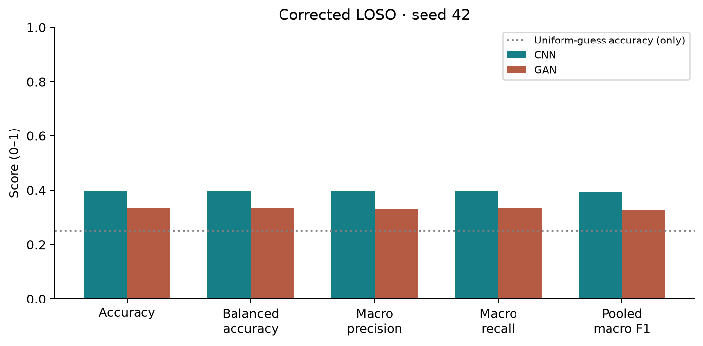

# PRML Expression Lab — CNN versus AC-GAN

**Ahmdullah · IIT Guwahati · M.Tech, Signal Processing and Machine Learning · Electronics and Electrical Engineering**

A tested PyTorch study of **happiness, sadness, fear and neutral** using 48 original photographs from six subjects. A supervised CNN is compared with the **expression head of an AC-GAN discriminator**, using identical subject-disjoint test/validation partitions. The Streamlit research dashboard works without private images or checkpoints; prediction is enabled only when trusted weights are available locally.



## Measured evidence

| Experiment / aggregation | CNN | AC-GAN classifier |
|---|---:|---:|
| Corrected pooled accuracy | 39.58% (19/48) | 33.33% (16/48) |
| Corrected pooled balanced accuracy | 39.58% | 33.33% |
| Corrected pooled macro precision | 0.3957 | 0.3304 |
| Corrected pooled macro recall | 0.3958 | 0.3333 |
| Corrected pooled macro F1 | 0.3927 | 0.3288 |
| Corrected mean **fold** macro F1 | 0.2784 | 0.1917 |
| Historical replay-verified accuracy | 33.33% | 25.00% |
| Historical mean fold macro F1 | 0.2011 | 0.1000 |

Six people are the sampling units; 48 photographs are not 48 independent people. Uniform guessing has expected accuracy 25%. The CNN's three-image advantage is descriptive, not a statistically established or universal result. These models estimate appearance labels, **not actual emotions or mental state**. Scores are uncalibrated and the models have limited generalization evidence.

## Run locally

Use **Python 3.12**. CPU training/inference is supported; CUDA is optional. Direct dependency versions are pinned; transitive versions can vary. The measured run used PyTorch 2.14.1+cpu, NumPy 2.2.6 and four CPU threads. Hardware/software and source hashes are in `results/corrected/run.json`.

```bash
python -m venv .venv
# Windows: .venv\Scripts\activate
# macOS/Linux: source .venv/bin/activate
python -m pip install torch==2.14.1 --index-url https://download.pytorch.org/whl/cpu
python -m pip install -r requirements-dev.txt
python -m pip install -e . --no-deps
python -m pytest -q
python -m streamlit run app/streamlit_app.py
```

The app never retrains during startup. Its seven pages are Overview, Dataset Explorer, CNN Explorer, GAN Explorer, Model Comparison, Prediction Studio and Research Report. Results, equations, architectures, fold curves, confusion matrices and report downloads work without model weights. Missing weights disable upload inference visibly; predictions are never filled with random outputs.

## Private dataset setup

Extract the supplied private archive locally:

```text
data/raw/
  sadness/    004_o_m_s_a.jpg ...
  happiness/  004_o_m_h_a.jpg ...
  neutral/    004_o_m_n_a.jpg ...
  fear/       004_o_m_f_a.jpg ...
```

The validator also discovers folders named `Happiness PRML`, etc. A nested root must identify exactly one folder per class. Labels follow the recovered mapping sadness=0, happiness=1, neutral=2, fear=3. Numeric filename prefixes define subjects; expression codes must agree with the class folder. Every image is decoded; corrupt files, ambiguous filenames, duplicate pixels, missing classes and incomplete fold class coverage fail clearly. No images are silently skipped.

```bash
python -m scripts.validate_dataset --data data/raw
python -m scripts.verify_results
```

The audited 48 images all have original dimensions 2835×3543. Exact duplicates: zero. Perceptual matches are review candidates; seven cross-subject pairs were visually reviewed as distinct photographs and their SHA256 pairs are recorded in `results/duplicate_review.json`. Modified input hashes invalidate that review. Real photographs, checkpoints, generated samples and private example grids are ignored by Git. No public image-distribution permission is assumed.

## Reproduce the corrected experiment

Each fold uses four subjects / 32 images for training, the next sorted subject / 8 images for validation, and one held-out subject / 8 images for testing. This is LOSO testing with one subject-disjoint validation holdout per fold. Preprocessing is fixed EXIF→RGB→64×64 bilinear resize→[−1,1]; augmentation is horizontal flipping on training images only for both methods.

```bash
python -m prml.train --data data/raw --output results/runs/new-run --duplicate-review results/duplicate_review.json
python -m scripts.verify_run --data data/raw --run results/runs/new-run
python -m scripts.export_results --source results/runs/new-run
python -m scripts.build_report
python -m scripts.private_diagnostics --data data/raw --run results/runs/new-run
```

Defaults: 25 CNN epochs, 40 GAN epochs, batch eight, Adam lr 0.0002, seed 42+fold. Seeds reset independently before each model; GAN Adam betas (0.5,0.999), CNN (0.9,0.999). Minimum validation classification CE selects the epoch. Test labels never enter training or selection. A smoke check can use `--smoke --cnn-epochs 1 --gan-epochs 1` with a separate output directory; smoke runs cannot be exported as research results. Existing run directories cannot be overwritten accidentally.

The CNN has three conv/BN/ReLU/max-pool blocks, channels 16/32/64; dense 4096→64→4 with dropout 0.3. AC-GAN uses noise 64+class embedding 16, a convolutional generator, and a four-stage discriminator with source and class heads. The corrected discriminator learns classes on both real and fake images. Generator source loss is explicitly non-saturating. Generator and discriminator are checkpointed at the same selected epoch. Full loss weights and equations are in the report.

`results/corrected/` contains public JSON evidence and histories; `results/figures/` contains statistical plots and architecture diagrams. `results/runs/` contains ignored full local runs/weights. `results/private/` contains ignored generated grids, OOF correct/incorrect examples with scores, and nearest-training-image distances. Distances are low-resolution pixel diagnostics, not proof against memorization. No synthetic face images are published by default.

## Inference and local face display

Set `PRML_CHECKPOINT_DIR` on the server to the directory containing `fold_0/cnn.pt`, `fold_0/gan.pt`, etc. The local default is `results/runs/corrected`. The app uses a fixed fold selected explicitly for demonstration, not the fold with the best test score. Fold models are not validated general-purpose production models. Do not use an ensemble of folds to claim unbiased predictions on training identities: other folds have trained on that identity.

```bash
python -m prml.predict --checkpoint results/runs/corrected/fold_0/cnn.pt --image private/example.jpg
```

Checkpoint loading uses CPU mapping, `weights_only=True`, strict state shapes and exact class/size metadata. Uploaded images are handled in memory. The optional gallery requires `PRML_PRIVATE_DATA` and `PRML_ALLOW_FACE_DISPLAY=1`; use only in an authorized private session. The public dashboard contains no source faces or weights.

## Historical recovery and verification

The remote initially contained only a README at commit `e10ee954bc521d764d84f9ca6ffd030a1ccdfe6b`. The supplied local data path revealed earlier source, reports, six folds, histories and 18 checkpoints. `legacy/` preserves the old source/report; `results/historical/` preserves JSON evidence. All 12 recovered classifiers reproduced their 48 OOF labels per method; arithmetic agrees with the stored summary. Original training was not rerun. Original environment metadata is unavailable, and generator weights were not paired with selected discriminator epochs.

To replay recovered classifiers against the separate private old checkpoint directory:

```bash
python -m scripts.verify_results --data data/raw --checkpoints PRIVATE_OLD_RESULTS
```

The corrected run changes the fake-label D loss, selection criterion, seed reset and checkpoint pairing. Historical-versus-corrected performance changes cannot be attributed to a single factor without ablations. Pooled macro F1 and mean fold macro F1 are separate. Exploratory uncertainty resamples subjects, with six-cluster and overlapping-training caveats.

## Streamlit Community Cloud deployment

1. Connect an authorized GitHub account at [Streamlit Community Cloud](https://share.streamlit.io/).
2. Create an app for `Ahmdullah16/PRML-Assignment`, using the reviewed implementation branch or merged `main`.
3. Set main file path **`app/streamlit_app.py`** and Python **3.12** in advanced settings.
4. Requirements and theme are read from the repository root. Deploy the inference-only app; no data download or training is required.
5. Verify all seven pages. Without privately provisioned approved weights, Prediction Studio must show its unavailable state.

Weights are not automatically uploaded or fetched. For an approved private deployment, provision weights out of band and set `PRML_CHECKPOINT_DIR`. Do not put credentials in code or expose the dataset via app storage. Consult the [official deployment guide](https://docs.streamlit.io/deploy/streamlit-community-cloud/deploy-your-app). No live public deployment is claimed unless the delivery log records a verified URL.

## Verification and report

CI installs CPU PyTorch, tests data integrity/leakage, architectures, probabilities, adversarial gradients, loss behavior, deterministic inference, strict loading, one-epoch optimization, metric arithmetic and all seven Streamlit pages. It verifies public historical arithmetic without private images and never runs full training.

Read [the academic report](reports/ASSIGNMENT_REPORT.md), [recovery/audit notes](reports/AUDIT.md) and the delivery log for current PR/check/deployment status. The report cites authentic CNN, GAN and AC-GAN literature and separates measured findings from hypotheses.
