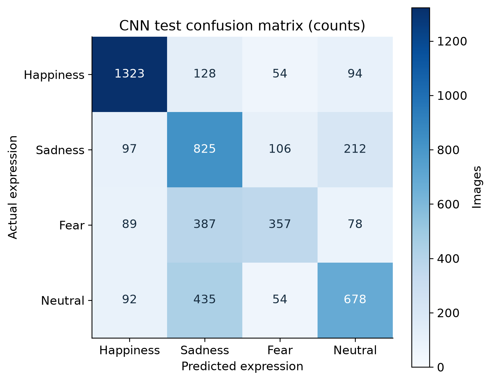
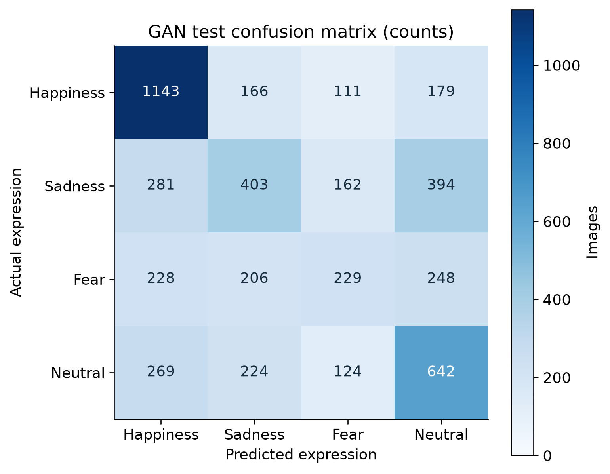
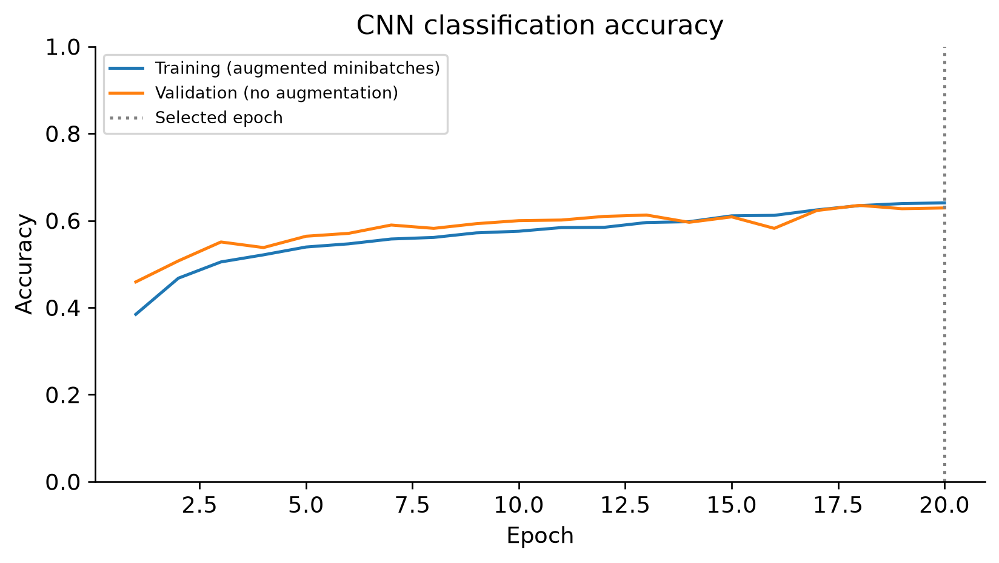
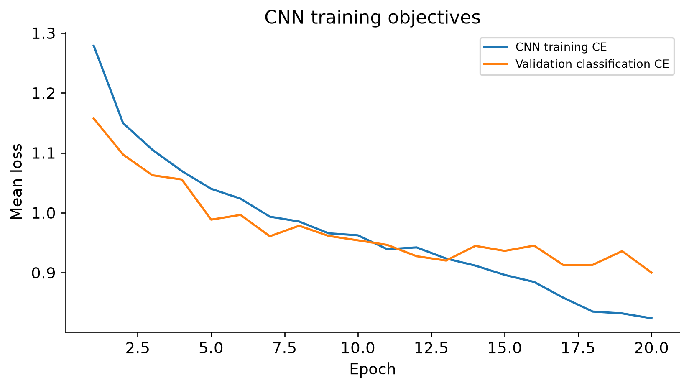
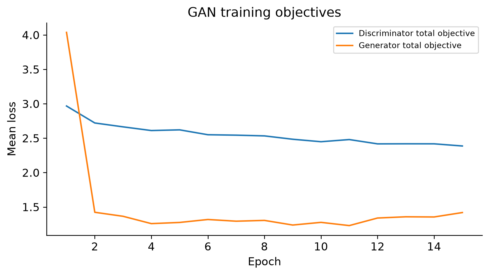
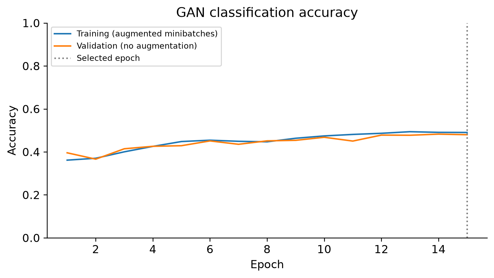
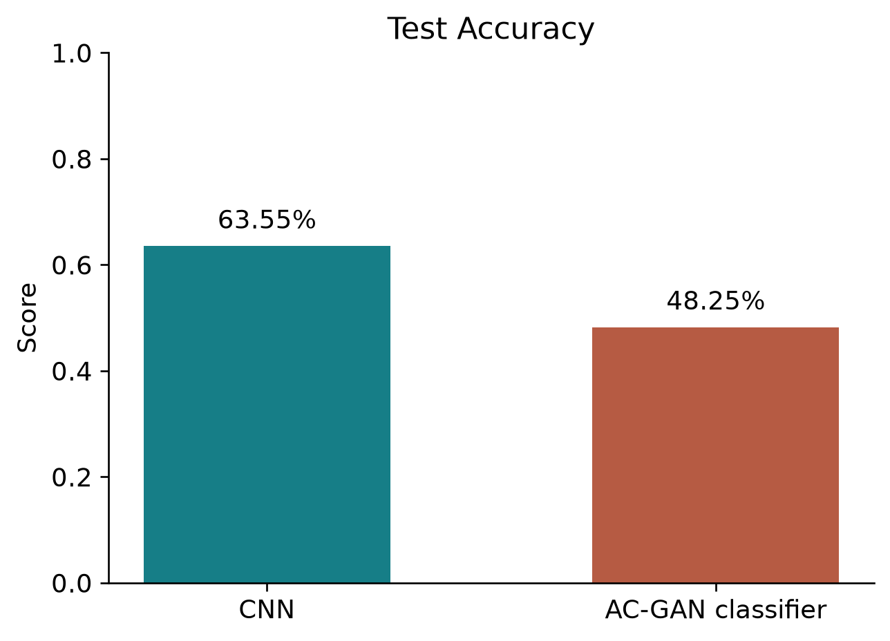
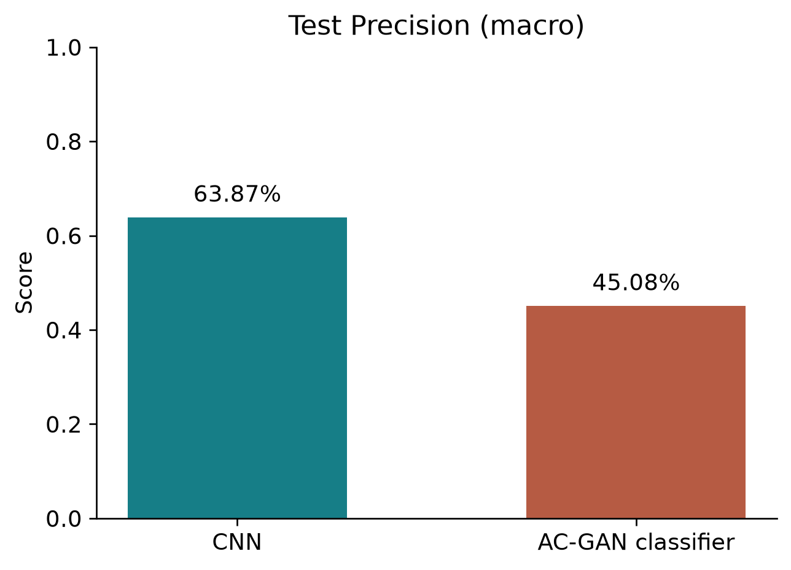
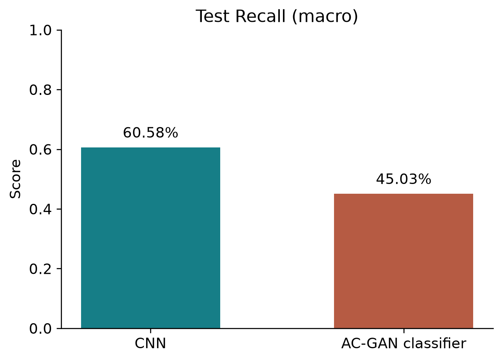
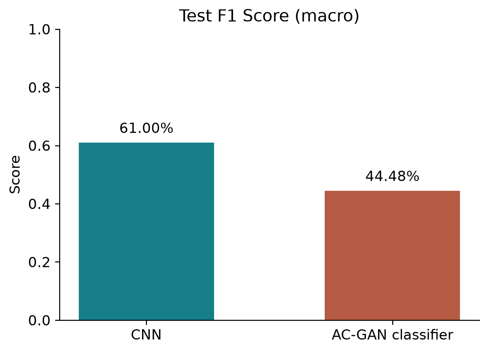

# Classification of Facial Expressions into Happiness, Sadness, Fear and Neutral Using CNN and GAN: A Comparative Study

**Student:** Ahmdullah

**Roll Number:** 264102307

**Institution:** IIT Guwahati

**Course:** Pattern Recognition and Machine Learning

**Program:** M.Tech - Signal Processing and Machine Learning

**Department:** Electronics and Electrical Engineering

## 1. Assignment objective

Retrain a supervised convolutional neural network and an Auxiliary Classifier GAN from scratch to classify images into Happiness, Sadness, Fear and Neutral. Compare the CNN output with the discriminator auxiliary class head on identical held-out images. The generator is not a classifier.

## 2. Dataset information and provenance

Source: dilkushsingh/facial-emotion-dataset on Kaggle, with documented upstream dilkushsingh/Facial_Emotion_Dataset. Local download contains train_dir and test_dir. The selected original folders contain 25,053 files. All valid selected images are 48x48 JPEGs. The local LICENSE is CC BY 4.0. The Kaggle API listed version 17, last updated 2026-10-17; the local download's exact Kaggle version cannot be proven. SHA256 manifests identify the actual experimental snapshot.

The download contained 393 invalid training JPEGs whose contents were GitHub HTTP 429 error text. Valid files were recovered from the documented upstream archive into a private working copy, leaving the original unchanged. Repaired hashes and archive hash are recorded in repair_provenance.json. All 25,053 selected file hashes match the documented upstream archive byte-for-byte; observed upstream commit 444c3b5871d5404012abec91466ce1817df66af9 is recorded in upstream_comparison.json. No held-out file needed repair. Raw facial photographs are excluded from the repository and submission.

## 3. Four selected classes and label mapping

Folders happy, sad, fear and neutral map to Happiness, Sadness, Fear and Neutral. Angry, disgust and surprise are excluded. For compatibility with the existing checkpoints, numeric labels are sadness=0, happiness=1, neutral=2, fear=3. Confusion-matrix figures reorder both axes to Happiness, Sadness, Fear, Neutral; saved metric matrices explicitly retain numeric label order.

## 4. Training, validation and test protocol

Preserve every valid selected original test image: 5,009 test records. Validation is approximately 15% of eligible original training data, stratified by class with seed 42 and entire duplicate groups assigned together. Exact duplicates use decoded RGB SHA256; near-duplicate candidates use 64-bit dHash Hamming <=3 AND grayscale 32x32 RMSE <=0.06; conservative grouping, not subject identity. The audit found 604 exact-duplicate groups and 540 conservative near-duplicate pairs. Training groups touching test are excluded, redundant exact training copies removed, and conflicting-label training groups excluded: 868 files in total. No file, exact pixel hash, or audited duplicate group overlaps partitions. The 5,009 original test records contain 4,971 unique decoded pixel hashes (38 repeated records); one exact-pixel test group has conflicting source labels. Original test membership and annotations are retained for both classifiers. These issues reduce effective sample independence and expose annotation uncertainty; details are in test_duplicate_summary.json. Subject identifiers are unavailable. These are image-level results, not subject-independent estimates. Heuristics cannot guarantee absence of every near duplicate. Both models use exactly the same saved manifest; test labels do not select hyperparameters or checkpoints.

| Expression | Training | Validation | Test |
| --- | --- | --- | --- |
| Happiness | 5307 | 936 | 1599 |
| Sadness | 4029 | 711 | 1240 |
| Fear | 2821 | 498 | 911 |
| Neutral | 4143 | 731 | 1259 |
| Total | 16300 | 2876 | 5009 |

## 5. Image preprocessing

Apply EXIF orientation correction, RGB conversion, bilinear resize to 64x64 and float32 scaling x/127.5 - 1. Both models use random horizontal flips only during training. Validation and test preprocessing are deterministic with no augmentation. A uint8 training/validation cache avoids repeated decoding. No test pixels are loaded during the training program.

## 6. CNN architecture and mathematical formulation

The existing CNN is reused unchanged: three convolution 3x3 / batch normalization / ReLU / max-pool blocks with 16,32,64 channels. At 64x64 input, flatten the 64x8x8 features to 4096, then dense 64, ReLU, dropout 0.3, and dense 4 logits.

p(y=k|x) = exp(z_k) / sum_j exp(z_j). L_CNN = -log p(y|x). Training uses cross-entropy on logits; softmax is applied at inference. Scores are uncalibrated.

## 7. AC-GAN architecture and mathematical formulation

The existing conditional generator concatenates 64-dimensional Gaussian noise and a 16-dimensional class embedding, projects to 256x4x4, then applies four transposed-convolution stages with channels 128,64,32,3. Batch normalization and ReLU precede the final Tanh RGB 64x64 output. The discriminator has four stride-2 4x4 convolutions with 32,64,128,256 channels and LeakyReLU 0.2. Flatten 4096 features into a source logit and four expression logits.

L_D = BCE(D_s(x),1) + BCE(D_s(G(z,c)),0) + CE(D_c(x),y) + CE(D_c(G(z,c)),c). L_G = BCE(D_s(G(z,c)),1) + CE(D_c(G(z,c)),c). All loss weights are one. BCE uses logits and the generator objective is non-saturating. Fake images are detached during the D update; D parameters are frozen during the G update while preserving derivatives through D to G. Both gradients are checked for finiteness, generator gradients for nonzero propagation, and gradient norms clipped to 10. Generator and discriminator snapshots use the same validation-selected epoch. Generated grids remain private because image quality and possible training-image memorization are not established.

## 8. Training configuration and hardware

Both methods start from random weights with seed 42 on the full eligible training partition. CNN uses AdamW, lr 0.001, betas (0.9,0.999), weight decay 0.0001; ReduceLROnPlateau monitors validation CE, factor 0.5, patience 2, floor 1e-5. GAN D uses AdamW with zero weight decay and G uses Adam; both lr 0.0002 and betas (0.5,0.999), fixed LR. Batch size 64. Budget: 20 CNN epochs, 15 GAN epochs; early stopping after five validation epochs without a CE improvement of at least 1e-5. Minimum validation CE selects checkpoints. This is a single-seed, fixed-budget classroom comparison, without architecture-matched ablation or exhaustive tuning.

Hardware: Intel Core i5-1135G7, 4 physical cores / 8 logical processors; CPU execution with four PyTorch threads; Intel Iris Xe integrated graphics, no CUDA GPU. Environment: {"python": "3.12.14", "torch": "2.15.0+cpu", "numpy": "2.5.4", "platform": "Windows-11-10.0.26200-SP0"}. Epoch duration includes in-epoch validation; total training duration excludes initial image caching and final test evaluation.

| Setting | CNN | AC-GAN |
| --- | --- | --- |
| Executed epochs | 20 | 15 |
| Selected epoch | 20 | 15 |
| Classifier parameters | 286276 | 710629 |
| Generator parameters | 0 | 1022179 |
| Duration (seconds) | 1670.26 | 2065.76 |
| Maximum epochs | 20 | 15 |
| Batch size | 64 | 64 |
| Initial learning rate | 0.001 | 0.0002 |
| Early stopping patience | 5 | 5 |

## 9. Evaluation metrics and arithmetic validation

Accuracy = number of correct predictions / N. For class k: precision P_k = TP_k/(TP_k+FP_k), recall R_k = TP_k/(TP_k+FN_k), F1_k = 2*P_k*R_k/(P_k+R_k). Undefined divisions are assigned zero. Macro metrics are the arithmetic mean across all four classes: F1_macro = (F1_1 + F1_2 + F1_3 + F1_4)/4. Weighted F1 = sum_k (n_k/N)*F1_k, where n_k is test support. Balanced accuracy is macro recall. Reported metrics are independently cross-checked with scikit-learn and recomputed from saved test predictions. Confusion matrices count all eligible test records. The source-order matrices and labels are in summary.json.

## 10. CNN confusion matrix

Rows are actual expressions; columns are predicted expressions. Raw counts are shown, with a separate row-normalized matrix supplied. The matrix derives from the validation-selected CNN checkpoint and saved held-out predictions.

## 11. GAN classification confusion matrix

The matrix uses predictions from the discriminator auxiliary class head, not generated labels. Its rows and columns follow the same order and use the same held-out image list as the CNN.

## 12. Accuracy, precision, recall and F1 comparison

The measured comparison is shown below. Accuracy difference (CNN minus GAN) is 15.29 percentage points. Precision, recall and F1 in the main comparison are macro averages; weighted results are also supplied. Each model has 5,009 test predictions.

| Metric | CNN | AC-GAN classifier |
| --- | --- | --- |
| Accuracy | 0.635456 | 0.482531 |
| Precision (Macro) | 0.638696 | 0.450761 |
| Recall (Macro) | 0.605779 | 0.450281 |
| F1-score (Macro) | 0.610038 | 0.444777 |
| Balanced accuracy | 0.605779 | 0.450281 |
| Precision (Weighted) | 0.653030 | 0.466633 |
| Recall (Weighted) | 0.635456 | 0.482531 |
| F1-score (Weighted) | 0.633905 | 0.469189 |

### CNN per-class test metrics

| Expression | Precision | Recall | F1 | Support |
| --- | --- | --- | --- | --- |
| Happiness | 0.8264 | 0.8274 | 0.8269 | 1599 |
| Sadness | 0.4648 | 0.6653 | 0.5473 | 1240 |
| Fear | 0.6252 | 0.3919 | 0.4818 | 911 |
| Neutral | 0.6384 | 0.5385 | 0.5842 | 1259 |

### GAN per-class test metrics

| Expression | Precision | Recall | F1 | Support |
| --- | --- | --- | --- | --- |
| Happiness | 0.5950 | 0.7148 | 0.6494 | 1599 |
| Sadness | 0.4034 | 0.3250 | 0.3600 | 1240 |
| Fear | 0.3658 | 0.2514 | 0.2980 | 911 |
| Neutral | 0.4388 | 0.5099 | 0.4717 | 1259 |

## 13. Training graphs and interpretation

Training accuracy is aggregated from augmented minibatches while weights change; validation accuracy is measured in eval mode after each epoch. CNN train and validation losses are classification CE. GAN discriminator total loss contains four terms and generator total loss contains two; their magnitudes cannot be interpreted as equivalent to CNN CE. The selected epoch is indicated on accuracy plots. GAN losses and numerical gradient checks do not establish visual quality, sample diversity or freedom from mode collapse.

## 14. Results discussion and limitations

CNN obtains the higher test macro F1 in this executed run. A constant predictor choosing the most frequent training class (happiness) scores 31.92% test accuracy and 0.1210 macro F1; this baseline class is chosen from training counts only. The measured differences are descriptive evidence for these particular architectures, budgets, split and seed. They do not establish that one learning paradigm is universally superior. The CNN directly optimizes real-image recognition; AC-GAN shares representation capacity across real/fake discrimination and expression classification. Those objectives may compete. Architecture, parameter counts and adversarial compute differ, so this is a pipeline comparison rather than an isolated causal test of adversarial learning. Class imbalance makes macro and per-class metrics especially relevant.

Unavailable identities, retained within-test duplicates, imperfect duplicate detection, dataset annotation noise and a single random seed limit generalization claims. The supplied test set was used only after both training procedures completed. A private fixed-seed generator grid shows coarse face-like images and low within-class variation, particularly for sadness and happiness, consistent with partial mode collapse. This qualitative diagnostic does not establish diversity or absence of memorization. No quantitative synthesis-quality, calibration, demographic-fairness or real-world-robustness assessment was performed. These limitations do not invalidate the measured discriminator classification predictions, but prevent claims of successful high-quality facial synthesis. This report does not claim an accuracy improvement over previous 48-image studies, because their datasets and protocols differ.

## 15. Conclusion

The assignment implements genuine supervised CNN training and conditional adversarial G/D training, saves validation-selected consistent checkpoints, and compares both classifiers on the same held-out Kaggle partition. Reports, metrics, histories, exact splits and executable source are packaged to support reproduction. Predictions label facial appearance and do not establish actual emotion or mental state.

## 16. Attribution and references

Dilkush Singh. Facial Emotion Dataset. Kaggle: https://www.kaggle.com/datasets/dilkushsingh/facial-emotion-dataset. Documented upstream: https://github.com/dilkushsingh/Facial_Emotion_Dataset. Local metadata license: Creative Commons Attribution 4.0; raw source photographs are not redistributed.

LeCun et al. (1998). Gradient-based learning applied to document recognition. Proceedings of the IEEE. DOI: 10.1109/5.726791.

Goodfellow et al. (2014). Generative Adversarial Nets. NeurIPS. https://arxiv.org/abs/1406.2661.

Odena, Olah and Shlens (2017). Conditional Image Synthesis with Auxiliary Classifier GANs. ICML / PMLR 70:2642-2651. https://proceedings.mlr.press/v70/odena17a.html.

Paszke et al. (2019). PyTorch: An Imperative Style, High-Performance Deep Learning Library. NeurIPS. https://arxiv.org/abs/1912.01703.

